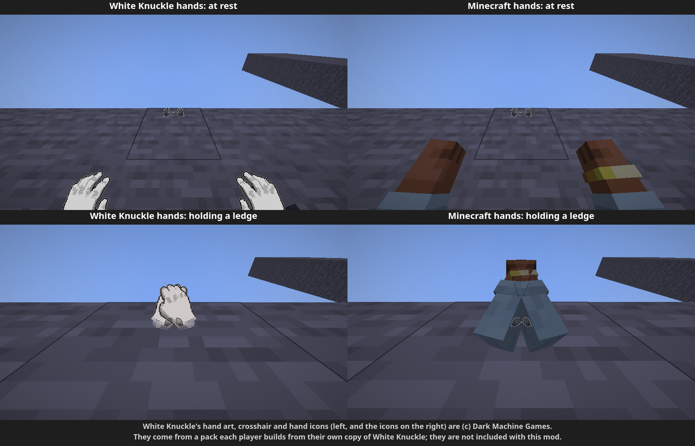

# White Knuckle Climbing

**Climb Minecraft like the White Knuckle climber.** Grab ledges with each hand, watch your grip run
out, swing from bars and chains, and move, sound and get hurt the way the game does. The
climbing, movement and health rules are rebuilt from White Knuckle's own code and data, and checked
against the game.

Minecraft Java Edition **26.3**, **Fabric**. Version **0.5.0 beta**: climbing only. Items, the
inventory and perks may come later. Works with both of 26.3's graphics engines, OpenGL and Vulkan.
All new versions are for 26.3. Minecraft 1.21.9 is legacy:
[0.4.0 beta](https://github.com/Fizz12215/White-Knuckle-Climbing/releases/tag/v0.4.0-beta) stays available for it,
but gets no more updates.

> An unofficial fan mod, not made or endorsed by Dark Machine, White Knuckle's developers. The mod
> contains none of the game's files: if you own White Knuckle, a small tool builds its hands and
> sounds into a resource pack from your own copy.

## Two kinds of hands
Pick the hands you climb with, the first time you start the game and any time after in the
settings (**Hands: White Knuckle / Minecraft**):
- **Minecraft hands:** two arms in **your own Minecraft skin**, out in front of you, moving exactly
  like White Knuckle's: they rest, sway, reach out and grab the ledges you hold.
- **White Knuckle hands:** the game's own hand pictures, which turn red as your grip runs out. They
  come from the asset pack, built from your copy of White Knuckle (see [Install](#install)).

Without the pack you get Minecraft hands automatically. Either way, other players see your arms
reach up to your holds, and so do you in third person (F5).

*White Knuckle's hand art, crosshair and hand icons in these screenshots are © Dark Machine Games.
They come from the pack each player builds from their own copy of White Knuckle, and are not included
with this mod.*

## What you get
- **Two-handed grip climbing.** Left mouse is your left hand, right mouse your right. Hold a button
  while looking at a ledge (a block's top edge) to grab it; keep it held and the hand catches the
  next ledge you look at. Climb with W/S, shuffle with A/D, pull yourself up, jump between holds.
- **Grip per hand.** 10 seconds each while hanging, twice as long on two hands. Each hand turns red
  as its grip runs out (exactly like the game's hand shader), then lets go.
- **Bars, chains and rods** (chains, iron-bar posts, end and lightning rods, bamboo): grab anywhere
  and swing. Ladders, vines and buttons can be grabbed anywhere too.
- **Ice:** icy ledges slip out of your hand after 2 seconds, and icy floors are slippery.
- **White Knuckle's movement and camera:** walking, sprinting, crouching (with no "sneak" guard at
  ledges), jumping, air control, head-bob, sprint camera roll, and the game's lower camera height,
  so ledges sit in view where they do in White Knuckle.
- **White Knuckle's health:** no hunger, healing 5 seconds after the last hit, falls that only hurt
  past about 40 blocks, and the game's damage look (the screen washes out, greys and reddens as you
  get hurt, with blood and hit-direction glows).
- **Your choice of hands:** [Minecraft hands or White Knuckle hands](#two-kinds-of-hands).
- **With the asset pack:** White Knuckle's first-person hands, crosshair, hand icons, blood, and climbing,
  footstep, landing and voice sounds, the rushing wind of a long fall, and the heartbeat that fades in
  as you get close to death (at half the game's volume by default; see `low_health_volume`).

## Install
The download zip contains `README.txt` with the same steps in more detail, for **Windows** and
**Linux** (including Steam Deck).

1. **Fabric:** install [Fabric Loader](https://fabricmc.net/use/installer/) for 26.3 (or, in Prism
   Launcher, make a 26.3 instance and add Fabric under Edit > Version > Install Loader).
2. **Mods:** put [Fabric API](https://modrinth.com/mod/fabric-api) for 26.3 and
   `white-knuckle-climbing-0.5.0-beta.jar` in your `mods` folder:
   - Windows: `%APPDATA%\.minecraft\mods` (press Win+R and paste it)
   - Linux: `~/.minecraft/mods`
   - Prism: right-click the instance > Folder > `mods`
3. **Choose your hands:** start Minecraft. The first screen asks for **White Knuckle hands** or
   **Minecraft hands** (your skin). You can switch any time in the settings.
4. **White Knuckle's hands and sounds (optional, needs White Knuckle on Steam):** after the choice,
   the mod looks for your copy of White Knuckle and offers to build its hands and sounds from it
   (with Minecraft hands, the pack still adds the sounds, crosshair and blood).
   Press **Start**, and the screen walks you through up to four steps. **Each step says exactly what
   it will do on your computer, which folders it uses and how to undo it, and waits for you to press
   Continue** (you can Stop at any step):
   1. make a private Python folder (first time only);
   2. download the Python libraries the tool needs from pypi.org (first time only: about 35 MB on
      Windows, 45 MB on Linux; about 130 MB and 185 MB once installed);
   3. build the pack from your copy of the game (about 15 seconds; it only reads White Knuckle's files);
   4. turn the pack on.

   Notes:
   - It needs **Python 3.10 to 3.14**. On **Windows**, if Python isn't installed, the screen offers to
     install Python 3.13, and explains what that does first. **Linux** usually has it already
     (Ubuntu/Debian/Mint may also need `sudo apt install python3-venv`; the screen says so).
   - **If White Knuckle isn't found**, press **Choose its folder** and pick it in your system's own
     folder picker. That covers another drive, or a **Flatpak launcher** (Prism Launcher from Flathub,
     most Steam Deck setups), which can't see your Steam folder. In a Flatpak, choosing the folder lets
     the launcher read just that folder: no commands, no restart.
   - When a mod update needs a newer pack, the screen offers to rebuild it (two steps). Packs built
     for 0.4.0 or older need this once: 26.3 uses a newer pack format.
   - Please read [What the Build button does](#what-the-build-button-does-to-your-computer) and
     [Safety](#safety-what-this-access-means) below.
   - If the button can't run, the download zip also has the tool to do it by hand (the
     `asset-extractor` folder, explained in `README.txt`).

   Please don't share the pack, since it's the game's own art and audio.

## What the Build button does to your computer
Nothing happens until you press Continue on that step's screen, which shows the exact folders on your
computer.

| What | Where | Size | How to remove it |
|---|---|---|---|
| A private Python folder with the tool's libraries | Windows: `%LOCALAPPDATA%\wkclimb-extractor` Linux: `~/.local/share/wkclimb-extractor` Flatpak launcher: `~/.var/app/<launcher id>/data/wkclimb-extractor` | about 130 MB (Windows), 185 MB (Linux) | delete the folder |
| The pack | `.minecraft/resourcepacks/White Knuckle Assets` | about 3 MB | delete the folder |
| Turns the pack on | `.minecraft/options.txt` (Minecraft's own list) | - | Options > Resource Packs, move it to the left |
| Remembers the White Knuckle folder you chose (if you chose one) | `.minecraft/config/wkclimb.properties` (`wk_game_dir`) | - | delete that line |
| A log of what it ran and printed | `.minecraft/logs/wkclimb-assets.log` | small | delete the file |
| **Only if you press Install Python (Windows):** Python 3.13 | installed by winget, Windows' own app installer, from python.org | about 100 MB | Settings > Apps > Installed apps > Python 3.13 > Uninstall |
| **Only in a Flatpak, if you choose a folder:** read access to that folder for your launcher | your system's document portal | - | `flatpak document-unexport --doc-id=<id>` (the build step shows the exact command); `flatpak documents <launcher id>` lists what it can see |

It downloads only from pypi.org (and python.org, if you install Python). It only reads White Knuckle's
folder, and it never changes it.

## Safety: what this access means
Building the pack means running programs on your computer, and in a Flatpak, letting the launcher see
more than before. In plain words:

- **It runs downloaded code with your permissions.** The tool is the mod's own Python script plus
  libraries from pypi.org (UnityPy, Pillow, numpy and a few more). Like any program you install, they
  can do anything your user account can do. If one of those libraries were ever taken over by an
  attacker, its code would run on your computer too.
  - To make that less likely, the mod fixes the exact version of every library (`tools/requirements.txt`).
    PyPI never lets anyone change the files of an existing version, so new code only arrives when a
    mod update changes that list.
- **Only get the mod from its official page**
  ([GitHub releases](https://github.com/Fizz12215/White-Knuckle-Climbing/releases)). A modified copy
  could show the same screens and run something else. Be wary of any other mod showing a screen like
  this one.
- **Minecraft mods already have full access.** Outside a Flatpak, every mod you install runs with your
  user's permissions, so the Build button can't do anything a mod couldn't already do. What it adds is
  downloading and running more code, which is why every step asks first.
- **Folder access in a Flatpak.** A Flatpak launcher normally can't see your files, and that protects
  you from a bad mod in any of its instances. Every folder you let it see becomes readable by the
  launcher and every mod you run in it.
  - **Don't give it your whole Steam folder.** That folder also holds Steam's login and settings files
    (`config/`), which a bad mod could read. Choosing a folder gives access to that folder only. The
    fallback command the mod shows if the picker fails is limited to White Knuckle's folder too.
  - You can take the access away again (see the table above).
- **Installing Python (Windows)** adds a program to your PC and agrees to Python's license for you.
  Windows asks for your permission if it needs it. You can uninstall it like any other app.
- **What it never does:**
  - it never needs administrator rights (apart from Windows' own prompt when installing Python);
  - it never changes White Knuckle's files;
  - it never uploads anything;
  - it never uses the internet except pypi.org (and python.org for Python);
  - it never runs anything without a Continue from you.
- **The pack is White Knuckle's own art and audio.** It's for your own use; please don't share it.

## Controls
| Key | Action |
|---|---|
| Left / right mouse | left / right hand: hold to grab, release to let go |
| W / S | climb up / down; W on top of a ledge pulls you onto it |
| A / D | shuffle sideways |
| Space | jump off the wall (costs grip) |
| Left Ctrl | crouch; while hanging, brace against the wall |
| Left Shift | sprint |
| R | switch climbing mode on / off ("Toggle climbing mode" in Controls > Key Binds) |

- On first launch the mod sets White Knuckle's default keys: **Sprint = Left Shift, Crouch = Left
  Ctrl, Inventory = Tab** (the player list loses Tab). Change them back in Options > Controls >
  Key Binds whenever you like.
- While climbing mode is on, the mouse buttons are your hands: they don't break, place or attack.
  Press **R** to build or fight. The hotbar and hearts are hidden in climbing mode.

## Multiplayer
- Everyone needs the mod, and so does the host or server (LAN worlds work; for a server, install
  this mod and Fabric API on a Fabric 26.3 server).
- On a server **without** the mod, climbing switches itself off, because the server would otherwise
  kick you for flying.
- **For server owners:** the server trusts each player's game about when they're hanging (no fall
  damage or flying kick then). That's fine among friends, but on a public server a cheating client
  could misuse it.

## Settings
With [Mod Menu](https://modrinth.com/mod/modmenu) installed (optional), change them in game: **Mods >
White Knuckle Climbing > Config**. Hover over a setting for what it does. Volume sliders start at 0% (White Knuckle's volume) in the
middle and go up only as far as Minecraft lets each sound get louder. Without it,
edit `config/wkclimb.properties` (created on first launch):

| Setting | Default | Meaning |
|---|---|---|
| `fov` | `90` | field of view while climbing mode is on (White Knuckle's default); `0` uses Minecraft's |
| `reach_multiplier` | `1.0` | how far you can reach (1.0 = White Knuckle's 2 blocks) |
| `ledges_only` | `true` | only top edges can be grabbed; `false` lets you grab any face |
| `handholds_only` | `false` | `true`: only blocks in the `#wkclimb:handholds` tag can be grabbed |
| `enabled_on_start` | `true` | climbing mode on when the game starts |
| `hands` | `wk` | Your first-person hands: `wk` = White Knuckle's (needs the pack), `minecraft` = two arms in your skin. Without the pack, Minecraft hands are used |
| `blocks_per_unit` | `0.8` | the world scale: Minecraft blocks per White Knuckle unit |
| `exact_step_height` | `false` | `true`: White Knuckle's step height (0.18 blocks), so slabs and stairs must be jumped onto; `false`: Minecraft's 0.6 |
| `sound_volume` | `1.0` | volume of all the mod's sounds: `1` is White Knuckle's, `0` off, up to `2` (in the game: 0% in the middle, Off, +100%). Each kind below still stops at its own max |
| `grabbing_volume`, `landing_volume`, `footsteps_volume`, `hurt_volume` | `1.0` | grabbing and letting go; jumps, climbing up and landings; footsteps; hurt and death. `0` to `2` (twice as loud) |
| `fatigue_volume` | `1.0` | grip fatigue, `0` to `1.5` |
| `wind_volume`, `low_health_volume` | `1.0` | falling wind; the low-health heartbeat. `0` to `1.25` |
| `ice_volume` | `1.0` | icy handholds, `0` to `1`: the game already plays them at full volume |
| `wk_keybinds_applied` | `false` → `true` | set back to `false` to apply White Knuckle's keys again |
| `asset_prompt` | `true` | offer to build White Knuckle's hands and sounds when the pack is missing or out of date (`false` after "Don't ask again") |
| `wk_game_dir` | empty | White Knuckle's folder, set when you press **Choose its folder**, or by hand, for example `D:\SteamLibrary\steamapps\common\White Knuckle` |

Datapacks can change what is climbable through the block tags `wkclimb:handholds`,
`wkclimb:unclimbable`, `wkclimb:grab_anywhere`, `wkclimb:bars`, `wkclimb:icy_handholds`,
`wkclimb:slow_handholds` and `wkclimb:chain_sound`.

## Not in this beta
Items and tools in your hands, the White Knuckle inventory, perks and buffs, the grappling hook,
moving handholds, and White Knuckle's swimming (Minecraft's is used). The number keys still change
your held item even though the hotbar is hidden.

## Troubleshooting
- **Minecraft won't start:** check it's 26.3, with Fabric Loader 0.19.3 or newer and the Fabric API
  made for 26.3.
- **Minecraft's arm, crosshair and sounds instead of White Knuckle's:** the White Knuckle Assets
  pack isn't on (step 3). If
  you pressed "Don't ask again", set `asset_prompt=true` in `config/wkclimb.properties` and restart.
- **White Knuckle isn't found:** press **Choose its folder** on the setup screen (Steam: right-click
  White Knuckle > Manage > Browse local files shows where it is).
- **The build fails:** the screen shows the last lines, and the full log is
  `.minecraft/logs/wkclimb-assets.log`. Please attach it to a bug report.
- **Can't break or place blocks:** climbing mode is on, so press R.
- **Bug reports:** [open an issue](https://github.com/Fizz12215/White-Knuckle-Climbing/issues) with what you were doing, a screenshot or clip, and
  `.minecraft/logs/latest.log`.

## Credits
- **White Knuckle** is by Dark Machine. This mod is a fan tribute; please buy the game.
- Built on [Fabric](https://fabricmc.net/) and Fabric API. The asset tool uses
  [UnityPy](https://github.com/K0lb3/UnityPy), Pillow and soundfile.
- **AI disclosure:** this mod was written with Claude Code (Anthropic's Claude), working from the
  game's decompiled logic and data for reference only. No White Knuckle code or assets are
  included. Every mechanic was checked against the game or with automated in-game tests.
- License: MIT for the mod's own code (see `LICENSE`). White Knuckle's art and audio belong to Dark Machine and are not included,
  except one small screenshot of White Knuckle's hands on the "Choose your hands" page (credited there to Dark Machine Games).

Developers: [DEVELOPING.md](DEVELOPING.md) has the build, the code layout, where every number comes
from, and the test setup. [MODLOG.md](MODLOG.md) is the dated history of changes.
